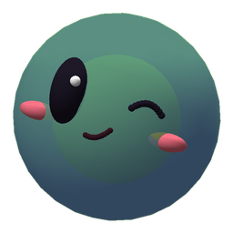
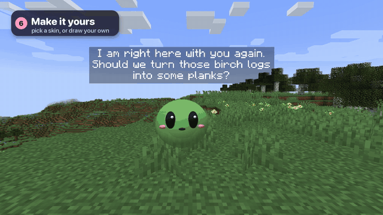

<div align="center">
  

# Kindred Spirit

**A cute AI companion for Minecraft Java that floats beside you, talks with you by voice, and never touches your world.**

Minecraft 1.21.1 · Fabric · MIT · early preview


</div>

Kindred Spirit is a little slime spirit (we call ours Pip) who keeps you company while you play.
Hold **V** and talk to it: it hears you, looks at your game (health, inventory, biome, time, what
you're looking at, monsters around you) and answers out loud. It also speaks up by itself when a
creeper sneaks behind you or your hearts run low.

- **Your world stays yours.** The mod is client-side only: no new blocks, items or mobs, nothing
  saved in your world. Add or remove it any time.
- **Bring your own AI.** One OpenAI-compatible address: Gemini by default; the gateway also has
  presets for Ollama, Groq, OpenAI, OpenRouter and Mistral (only Gemini is tested so far).
  Speech-to-text and voice run **locally**.
- **Light on your computer.** It adapts to your frame rate and hardware (see [Performance](#performance)).
- **Made to be hacked on.** The mod is thin; the personality lives in a small Python "brain".

## Where it comes from

Kindred Spirit was inspired by [Verity JE](https://www.curseforge.com/minecraft/mc-mods/verity-je), a mod
with an AI companion who lives in your world. I didn't care about its horror or its story. What
stayed with me was the idea of a companion that is **present**: it sees what you're doing, talks
with you, and keeps you company while you play. Kindred Spirit keeps only that idea and makes it
cozy and configurable. It isn't a fork: none of Verity's code or assets are used, and it's written
from scratch for Fabric.

> **Status: 0.1 preview.** It's playable and fun, but small. We're looking for contributors:
> see [what to build next](#help-wanted) and the [design](docs/DESIGN.md).

## What works today

| | |
|---|---|
| A slime ball drawn beside you | bounces and squishes, blinks, color follows its mood, mouth moves with its voice |
| Voice chat | hold **V**, speak, release; local Whisper hears you, local Kokoro answers |
| Typed chat | just type in the game's chat: in singleplayer everything goes to her; on a server, start with her name ("Pip, where are the cows?"). Or `/kindred <message>` (`/ks`). Set `chatMode` to `all`, `name` or `command` |
| In-game commands | `/kindred memory` (what she knows here), `memory worlds`, `memory import <world>` (bring what she knew about you from another world), `memory forget <words>`, `reset` (a brand-new companion for this world), and the gateway's special instructions: `persona`, `fact`, `hint`, `model` (`clear` removes), `instructions`, `pause`, `resume` |
| It understands your game | health, hunger, armor, effects, inventory, position, biome, time, weather, what you look at, nearby hostile mobs with direction |
| Real senses | she sees only what's in her line of sight from where she floats, hears by the game's own sound names ("zombie groans" behind a wall), feels rain, snow and the cold, watches what you do (placed, mined, crafted, ate), and finds the new more interesting than the familiar |
| Danger warnings | creeper within 8 blocks, lava or a big drop in the direction you're heading (also on the way she leads), health at 3 hearts or less: instant subtitle, voice right after, with cooldowns |
| Her glow | in the dark (night, caves) her soft light lights the way around her, in singleplayer: an invisible light that moves with her and is never left behind (`glow` in the mod's settings) |
| She has a heart | a whimsical character with a **bond meter**: kindness brings her closer and makes her open up, propose plans and play pranks; hitting her or being mean makes her keep her distance, sulk, or vanish for a while. She forgives quickly ([how](docs/HEART.md)) |
| She discovers her powers | she doesn't know what she can do until you ask. She answers at once ("I'll try!"), then the power slowly wakes up in the background: she senses something strange, maybe asks you a small favour, and then "I can sense diamonds now!" She remembers it after that |
| She helps | finds ores, animals ("where are the sheep?"), blocks, players and any structure or biome, and tells you which way; **leads the way** there, floating well ahead of you with an arrow and the distance at the top of the screen and a sparkle trail (she keeps ahead even when you sprint, follows a walking animal, and calls you back if you go the wrong way); pushes monsters away, places a torch, **chops a whole tree or mines a block** you look at (what drops goes in your inventory), **builds** simple shapes with you (a pillar, corners, a wall, a floor, an outline); magic style gives items and effects (haste, night vision, speed, healing, food...), all-powerful changes time and weather. When asked, as a standing request ("always protect me", "tell me when we're near diamonds"), or she offers if you asked before |
| It remembers and learns | who you are, what you like, your habits, your places, its own little personality, a diary of your sessions; reminders ("in 10 minutes", "at night", "next time we play") ([how](docs/MEMORY.md)) |
| It knows Minecraft | asked how something works, she answers from a local knowledge base of the Minecraft Wiki (current for your version) and learns pages she doesn't have yet in the background ([how](docs/KNOWLEDGE.md)) |
| Friends on LAN | one Pip, on the computer that runs her: friends with the mod see her exactly as you do, friends without it see a stand-in; everyone talks to her in chat; she finds, helps and stays with whoever you choose, and comes along when a friend hosts the world ([below](#friends-on-your-lan-world)) |
| Personality | greets you, small talk when it's been quiet a while (configurable), moods |
| Subtitles | above the slime, optional captions and a log in your chat (only on your screen) |
| It feels alive | looks where you look, looks back when you look at it, wanders around you when you stand still, dozes after a long quiet time, leans as it floats, blinks, its eyes move before its head, its face shows its mood (and it winks); hums little tunes with the game's note-block sounds; finds its way around walls and through doors instead of over the roof |
| You can direct it | say or type "stay here", "come here", "follow me", "look at me", "do a spin"; pet it by sneaking while looking at it |
| Skins | a slime, a soft cube, a fairy and a pixie with fluttering wings, a glowing wisp, a strawberry, a starry orb, Sprout with its leaves, or your own PNG ([how](docs/SKINS.md)) |
| Session logs | every play session gets a timeline and a summary in `~/.kindred-spirit/logs/sessions/`, shown on the dashboard, to see what went wrong |

In progress: Minecraft's own commands as her powers (instant building, flattening, a whole house), a
memory of places with coordinates, a heart for each friend, blueprints. Not yet: mining and crafting
jobs, the in-game settings screen. That's the [roadmap](docs/ROADMAP.md).

### What it may do: power and style

You decide how much it can do (`/kindred power`, `/kindred style`); the mod enforces it, not the AI.

| | grounded (only what really exists) | magic (things can appear) |
|---|---|---|
| **advisor** | talks, finds ores and animals, locates places, leads the way | same |
| **helper** (default) | + pushes monsters away, places one of *your* torches, chops, builds with your blocks | + gives items and effects, torches and blocks from thin air |
| **allpowerful** | + time and weather | + all of it |

Finding and guiding work everywhere; anything that changes the world works in singleplayer, when you
host LAN, and in a friend's LAN world whose game has Kindred (their game does it for her), done the
way a command would.

### Friends on your LAN world

One Pip, on your computer: your AI, her voice, her memory and her heart. Open your world to LAN and
friends join on the same Minecraft version (**release 1.21.1**):

- **With the mod (light mode):** they see her exactly as you do (her skin, face, moods, gestures and
  subtitles), drawn by their own game from what yours sends. No AI, Python or keys on their side.
  They talk to her in chat ("Pip, ..."); their talk key opens the chat with her name typed in, or uses
  their own speech-to-text if they've set up the brain. Her voice plays from your computer.
  (`sharedPip: "own"` in their settings gives them their own Pip instead.)
- **Without the mod:** they see a stand-in the plain game can draw (an Allay named after her that
  follows where she floats, hidden on your screen) and talk to her in chat the same way.

She answers them in chat as "[Pip] ...", knows who said what, and sees them in the world. You decide:

- **Who she stays with:** "Pip, stay with Robin" or `/kindred follow robin`; `/kindred follow me`
  brings her back.
- **Whether friends may ask for her powers** (`lanGuestPowers`, on by default): gifts, effects like
  haste or night vision, healing, finding, leading, protecting, within her power and style. Off: they
  only talk with her.

**A heart for each of them.** She has the same five feelings for each friend as for you (lighter:
she lives with you), moved by how they treat her: their words, their hits and pats (their game tells
yours who did it), kept across sessions. She's warm with the kind one and prickly with the one who's
mean to her. Their words don't change her bond with you, with one exception: when a friend hurts her
in front of you, she notices whether you stand up for her ("leave her alone" counts; saying nothing
costs a little trust). "From now on, do what Robin says" lets that friend ask her to follow them or
stay. The dashboard shows a card for each friend, and every session log says who asked for what.
`lanGuests: false` turns all of it off.

**When a friend hosts the world instead:** your Pip comes with you (her brain stays on your computer).
If their game has the mod, it shows her to everyone (an Allay for players without it), passes their
"Pip, ..." chat to your brain and her answers to their chat, and carries out her powers in their
world for you: protect, gifts, effects, chopping, building, time and weather (`lanVisitors` on their
side, on by default, lets them say no). Without the mod on the host's side, she's only with you:
she talks, sees, finds and leads, but can't change their world.

A friend setting up light mode on Windows: [PLAY-WITH-FRIENDS.md](docs/PLAY-WITH-FRIENDS.md).

### It shouldn't feel like a robot

Its movement is designed to feel like a small living thing, not a camera attachment:

- **Springs, never snaps.** Every movement eases in and settles: position, head, eyes. A change of mind
  curves instead of jerking.
- **It notices before it reacts.** A short, slightly random delay (0.1–0.35 s) before it turns to
  something, like a person noticing; threats get a faster reaction.
- **Eyes first, head after.** Its pupils jump to what caught its attention, and its head follows more slowly.
  Tiny eye flicks keep it from staring like a doll.
- **It keeps its spot.** Small turns of your head don't drag it around; it only floats back to your
  side once you've clearly turned away, and holds still while you look at it, so you can look it in the eyes.
- **Its own little life.** It drifts on smooth noise (never a visible loop), switches shoulders now and then,
  glances at animals and items, and wanders around you when you stand still. After a long quiet while it
  dozes ("z z z") and wakes with a little start when you move.
- **It stays out of your way.** It never parks in the middle of your view, and floats over walls instead of into them.

Gestures (nod, shake, spin, hop, wiggle, happy, shy, think, startle) are layered on top, and the AI can
add one to its replies when it fits ("[excited] {hop} Diamonds!").

**Every one of these is a switch**, so you can have anything from a calm companion that just floats
beside you to a curious one that wanders and plays. `/kindred life` lists them; change one in game
with `/kindred life <name> <value>` (saved right away), or `/kindred life reset`:

| Switch | Default | What it does |
|---|---|---|
| `wander` | on | wanders around you when you stand still |
| `drift` | 1 | gentle drifting beside you: 0 still, 1 normal, 2 lively |
| `switchSides` | on | switches shoulders now and then |
| `glances` | on | glances at animals, items and around (off: looks where you look) |
| `lookBack` | on | looks back at you when you look at it |
| `eyeContactReactions` | on | gets happy or shy when you hold its gaze |
| `petting` | on | sneak while looking at it to pet it |
| `watchThreats` | on | turns to watch nearby monsters |
| `moodGestures` | on | hops when excited, looks up while thinking |
| `aiGestures` | on | plays the gestures the AI adds to its replies |
| `dozeAfterSeconds` | 90 | dozes off after this many quiet seconds; 0 = never |
| `turnSlack` | 32 | degrees you can turn before it floats back to your side; 0 = always right at your side |
| `keepOutOfView` | on | never parks in the middle of your view |

## How it fits together

```
Minecraft 1.21.1 + Fabric
  └─ Kindred Spirit mod (Java, client only): draws Pip, reads the game, acts when allowed, mic and speaker
        │  WebSocket on 127.0.0.1:47811, with a token from ~/.kindred-spirit/token
  Kindred brain (Python): conversation, moods, danger rules, tools, memory and learning
        │  one address
  Kindred gateway :11437 — choose each part (docs/GATEWAY.md):
        ├─ AI              Gemini / Ollama / Groq / OpenAI / …
        ├─ speech-to-text  local Whisper / Groq / OpenAI
        ├─ voice           local Kokoro / OpenAI
        ├─ embeddings      local bge-small / Gemini / Ollama / OpenAI
        └─ memory          local SQLite / a gateway you deployed elsewhere
```

The whole picture (the three ways she thinks, how her character is put together, memory, guards,
and which AI model fits each job) is in [docs/ARCHITECTURE.md](docs/ARCHITECTURE.md).

**Why a separate brain?** The mod only sees, draws and plays sound. Everything that makes the
companion *itself* is Python, which is quicker to change and easier to contribute to, and any AI
can sit behind the gateway.

**Why not build on MCPFabric?** [MCPFabric](https://github.com/denfry/mcpfabric) (MIT) is
excellent for letting AI agents *play* Minecraft: 70+ tools, many of them operator-level, over an
HTTP bridge plus a Node MCP server. Kindred needs a mod anyway to draw the companion, and what the
brain reads is a small snapshot; adding MCPFabric would mean two mods, Node, and an operator-level
bridge for a companion that by design never changes your world. So the mod carries its own small
bridge (~150 lines). MCPFabric stays the reference for later phases (actions, an MCP server for
outside agents), where we may interoperate or borrow MIT code with credit.

## Setup (macOS, about 10 minutes)

You need Minecraft Java Edition and [Homebrew](https://brew.sh). For the AI, use what you already
have: a free [Gemini key](https://aistudio.google.com/apikey), your Claude subscription (Claude
Code), another AI's command-line tool you pay for (Codex, Gemini CLI, Cursor), an API key (OpenAI,
Claude API, Groq, OpenRouter, Mistral), or nothing at all with [Ollama](https://ollama.com) on your
computer.

```bash
brew install openjdk@25 python@3.12 whisper-cpp
git clone https://github.com/PetitPotam/kindred-spirit.git && cd kindred-spirit
scripts/setup.sh                 # the guide (below)
(cd mod && ./gradlew build)      # builds the mod
python3 scripts/install_profile.py      # quit the Minecraft Launcher first
```

`setup.sh` prepares the brain, then a short guide asks what you have for each of the four parts:
**the AI** (how she thinks), **speech-to-text** (how she hears you), **the voice** (how she
speaks; or subtitles only) and **memory** (on your computer or your own deployed gateway). It
saves your choices (keys go in `~/.kindred-spirit/secrets.env`, readable only by you), installs
only the local tools you picked, starts everything and tests each part the way she uses it:

```
  ok   AI           Hello, friend, there!
  ok   voice        65 KB of WAV
  ok   speech->text heard: 'Testing 1 2 3.'
  ok   embeddings   384 numbers per text
  ok   memory       stored, found and removed a test memory
```

Anything that fails comes with how to fix it. Run the guide again any time to change your choices
(`brain/.venv/bin/python scripts/guide.py`), or just the test (`... scripts/guide.py --check`).
Without questions: `scripts/setup.sh --defaults` (Gemini, everything else local).

`install_profile.py` adds a **Kindred Spirit (Fabric 1.21.1)** profile with its **own game folder**
(`minecraft-kindred`), installs Fabric Loader and Fabric API, and backs up your launcher profiles.
Your other profiles, mods and worlds are untouched.

Then play: double-click **`scripts/play-mac.command`**. It starts everything and opens the launcher
**from Terminal**, which matters on macOS: the launcher has no microphone permission of its own,
so started from the Dock the game records silence. Pick the Kindred Spirit profile and press Play.

**Linux:** the scripts are written to work there (`whisper-server` from [whisper.cpp](https://github.com/ggml-org/whisper.cpp)) but haven't been tried yet.
**Windows:** not tested yet. The Python parts are cross-platform, but the start scripts are bash;
a PowerShell version is a [good first issue](docs/GOOD_FIRST_ISSUES.md).

### Controls

| | |
|---|---|
| **V** (hold) | talk; release to send (change it in Controls → Kindred Spirit) |
| just type in chat | talk to her (on a server, start with her name); or `/kindred <text>`, `/ks <text>` |
| `/kindred status` | brain connection, skin, mode, quality level, mood |
| `/kindred reconnect` | after restarting the brain |
| `/kindred skin <name>` · `/kindred skins` · `/kindred skins reload` | change its look, list skins, reload your skins folder |
| `/kindred mode follow\|stay\|come` | follow you (default), wait here, come close for a moment |
| `/kindred follow <player>` · `/kindred follow me` | on LAN: float beside a friend, or come back to you |
| `/kindred heart` · `/kindred heart fresh` | how she feels about you (five feelings, open hurts), or a fresh start for her heart here |
| `/kindred side left\|right\|above\|auto` | which side it floats on |
| `/kindred look me\|there\|ahead\|up\|down\|around` | where to look for a few seconds |
| `/kindred emote <name>` | nod, shake, spin, hop, wiggle, happy, shy, think, tease (a wink), doze |
| `/kindred life` · `/kindred life <name> <value>` · `/kindred life reset` | its liveliness switches (see above) |
| `/kindred power advisor\|helper\|allpowerful` · `/kindred style grounded\|magic` | what it may do (see above) |
| sneak while looking at it | pet it |

Mostly, you just talk to her, and discover what she can do along the way (that's the point, so
this list is for the curious): "stay here", "come here", "look at me", "do a spin", "any diamonds
near me?", "where are the sheep? lead the way", "where's the nearest village? take me there", "push them away", "always protect me",
"this is my base", "remind me in 10 minutes to check the furnace", "put my block back".

## Watching her think

`scripts/start.sh` also starts a dashboard at **http://127.0.0.1:11440**: her heart and mood live,
friends in your world (whom she stays with, what they may ask), powers waking up, what she says and
does, every AI call with its tokens and cost, speech and voice timings, her memories per world (with a
search that shows what she'd recall), past play sessions (replay what she said), **Try Pip** (talk to
her without the game), and **every setting** with its default, profiles to save and compare, and the
gateway's special instructions. Changes apply live. See [docs/DASHBOARD.md](docs/DASHBOARD.md).

## Settings

- **Brain:** `~/.kindred-spirit/brain.toml` (name, personality, model, voice, chattiness, alerts).
- **Mod:** `minecraft-kindred/config/kindredspirit.json` (skin, quality, subtitles, captions, position, size,
  volume, the guide arrow and sparkle trail (`guideArrow`, `guideTrail`), friends on LAN (`lanGuests`,
  `lanGuestPowers`, `lanVisitors`, `sharedPip`, `follow`), and the liveliness switches under `"life"`).
- **Everything above** is also editable on the dashboard's Settings page, live, with each default and profiles.
- **AI, speech-to-text, voice, embeddings, memory storage:** all chosen in the gateway, live, no
  restart. The guide: **[docs/GATEWAY.md](docs/GATEWAY.md)**.
  ```bash
  G="brain/.venv/bin/python services/kindred_gateway.py"
  $G check                      # tests every part
  $G use ai ollama              # or gemini, groq, openai, openrouter, mistral
  $G use stt groq               # or local_whisper, openai
  $G persona "Speaks like a pirate."
  ```
  Keys go in `~/.kindred-spirit/secrets.env` (readable only by you).
- **Memory:** each world has its own companion by default; `scripts/memory.sh` shows what she remembers, `worlds` and `import` bring memories from one world to another, `reset` starts over ([how it works](docs/MEMORY.md)).
- **What she knows about Minecraft:** a local knowledge base (recipes, mobs, biomes, redstone, farming, build guides) you fill yourself from the Minecraft Wiki and your own notes: `python3 services/knowledge/kb.py crawl minecraft-wiki --category Mobs --limit 50` ([docs/KNOWLEDGE.md](docs/KNOWLEDGE.md)). She uses it when you ask how something works, and learns missing pages in the background.
- **Her heart** (discovering her powers, bond, pride, play-fights, her mood, animals, pranks, mischief when angry, vanishing...): `[heart]` in brain.toml ([docs/HEART.md](docs/HEART.md)).
- **Her voice:** set in the gateway: Kokoro's British `bf_lily` by default (a little faster and higher, each
  sentence said a bit differently), with moods (excited, calm, sad, whisper); `$G voice bf_emma` or a blend
  like `bf_lily*0.7+bf_emma*0.3` to change it: [docs/GATEWAY.md](docs/GATEWAY.md#her-voice).
- Looks: `skin` in kindredspirit.json, or `/kindred skin <name>`. Make your own: [docs/SKINS.md](docs/SKINS.md).

## Performance

Built for laptops from the start (developed on a fanless MacBook Air M4):

- **The slime adapts to your frame rate.** `quality = "auto"` steps down to a simpler mesh without the
  glassy shell (and sends game snapshots less often, scans a smaller area) when the game drops below
  30 FPS for 3 seconds, and climbs back after 15 good seconds. With Fast graphics it never goes above
  medium. Or set `low`, `medium` or `high` yourself.
- **Nothing heavy on the game's threads.** Meshes are built once; drawing a frame allocates nothing.
  Network, JSON, the mic and playback each run on their own threads.
- **The helpers adapt to your hardware.** `python -m kindred.hardware` picks the Whisper model
  (large-v3-turbo, small or base) and thread counts from your memory and cores; all helpers run at
  low CPU priority so Minecraft wins when both want the CPU.
- **Fast replies.** Speech-to-text ~0.8 s for a short question (Whisper tuned for push-to-talk
  clips), voice streamed sentence by sentence with Kokoro's int8 model: about **3.4 s from releasing V
  to hearing the answer** on an M4 Air with Gemini Flash-Lite. Danger warnings appear instantly.

## Testing without breaking your game

Three levels, from fastest to most real:

1. **Automated tests, no game, no key, no network:** `cd mod && ./gradlew test` (Java logic) and
   `brain/.venv/bin/python -m pytest brain/tests` (brain, including an end-to-end test of the
   WebSocket protocol with stand-in AI and voice services).
2. **A fake game against your real setup:** with the brain running,
   ```bash
   cd brain
   .venv/bin/python tools/fake_game.py chat "what should I build?" --play
   .venv/bin/python tools/fake_game.py creeper --play
   .venv/bin/python tools/fake_game.py speak "what's around me?"   # Kokoro asks, Whisper hears
   ```
3. **A sandbox Minecraft:** `cd mod && ./gradlew runClient -PdevScript=devscripts/smoke-test.txt` starts a
   throwaway dev game (its own folder, `mod/run`), creates a test world, talks to the companion,
   spawns a frozen creeper behind you, drops your health and takes screenshots in `mod/run/screenshots`.
   `devscripts/life-test.txt` does the same for its liveliness and every skin (eye contact, petting,
   gestures, stay and come, watching a creeper).

The demo video is made the same way: the sandbox films itself from a script and an editing script
adds titles, captions and music. See [demo/README.md](demo/README.md).

Only then install into your launcher.

## Privacy

By default everything runs on your computer except the AI you choose. When you talk to it, the
gateway sends your words, a short text description of your game, and the few memories that matter
for that message to that provider. With Ollama nothing leaves your machine. Your voice stays on
your machine with local Whisper, and your memories in `~/.kindred-spirit/memory/` (or on a gateway
you deploy yourself).
The bridge listens on 127.0.0.1 only and needs a token.

## Help wanted

Ideas sized for a first contribution are in **[docs/GOOD_FIRST_ISSUES.md](docs/GOOD_FIRST_ISSUES.md)**
(a settings screen, a PowerShell start script, more danger alerts, other shapes, a name tag, a
wake word...). Bigger plans are in the [roadmap](docs/ROADMAP.md). Start with
[CONTRIBUTING.md](CONTRIBUTING.md).

## Credits

Kindred Spirit stands on the work of many others: [Fabric](https://fabricmc.net),
[whisper.cpp](https://github.com/ggml-org/whisper.cpp) and OpenAI's Whisper,
[Kokoro](https://huggingface.co/hexgrad/Kokoro-82M) via [kokoro-onnx](https://github.com/thewh1teagle/kokoro-onnx),
[BAAI's bge-small](https://huggingface.co/BAAI/bge-small-en-v1.5) via [fastembed](https://github.com/qdrant/fastembed),
[websockets](https://github.com/python-websockets/websockets), the [Minecraft Wiki](https://minecraft.wiki) contributors
(CC BY-NC-SA 3.0) and [minecraft-data](https://github.com/PrismarineJS/minecraft-data), research on language agents
(Generative Agents, Talker-Reasoner, CoALA, MemGPT, MineCollab and [Mindcraft](https://github.com/mindcraft-bots/mindcraft)),
design notes from [MCPFabric](https://github.com/denfry/mcpfabric), and the idea of a companion who is always there
from [Verity JE](https://www.curseforge.com/minecraft/mc-mods/verity-je). Every library, model, dataset, service
and source, with its licence: **[THIRD_PARTY_NOTICES.md](THIRD_PARTY_NOTICES.md)**.

MIT licensed. Not an official Minecraft product; not approved by or associated with Mojang or Microsoft.
