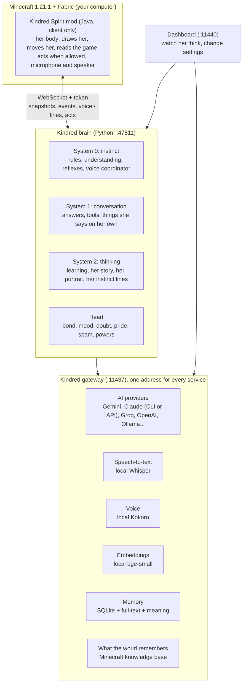
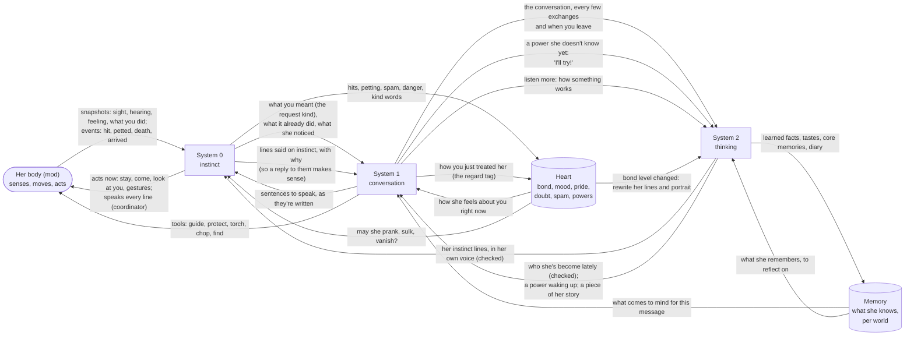
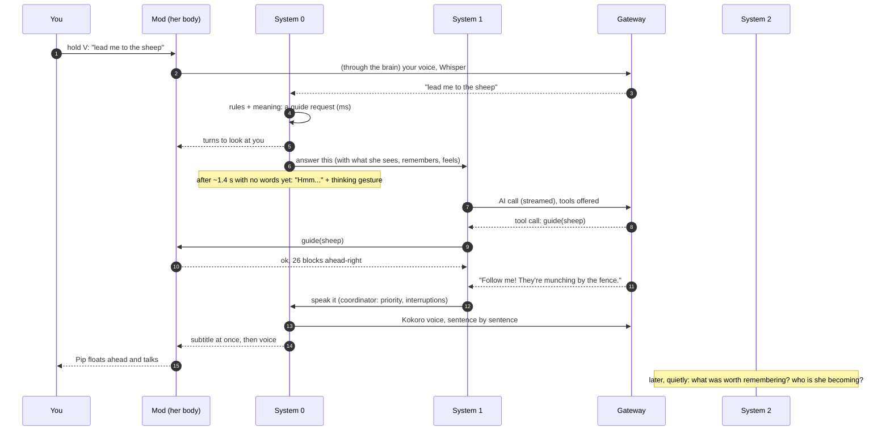
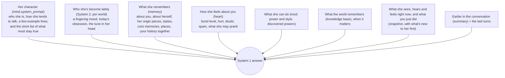

# How Pip works

This is the map of the whole companion: what each part does, how a moment in the game turns into
something Pip says or does, how her character is put together, and which AI model fits each job.
The other docs go deeper on one part each: [HEART.md](HEART.md) (her feelings and behaviour),
[MEMORY.md](MEMORY.md), [GATEWAY.md](GATEWAY.md), [KNOWLEDGE.md](KNOWLEDGE.md),
[DASHBOARD.md](DASHBOARD.md), [SKINS.md](SKINS.md), [ROADMAP.md](ROADMAP.md).

## The pieces

| Part | Where | What it does |
|---|---|---|
| **Mod** | `mod/` | Her body. Draws her (skins, glow at night), moves her (follow, guide, stay, keep out of your swing), reads the game into a **snapshot** about once a second, records your voice while you hold the talk key, plays her voice, runs the few actions she's allowed (protect, torch, chop, find). Client only: nothing is added to your world. |
| **Brain** | `brain/kindred/` | Everything that makes her *her*: the three systems, her heart, memory and learning. Python, so it's quick to change. |
| **Gateway** | `services/kindred_gateway.py` | One local address for AI, speech-to-text, voice, embeddings, memory and knowledge. Each player picks their own providers (their own key or subscription); nothing is shared. |
| **Local services** | `services/` | Whisper (`:8083`), Kokoro (`:8885`), embeddings (`:8891`), speech cleaner, memory store, knowledge base, dashboard (`:11440`). All on your computer. |

The mod talks to the brain over a WebSocket on `127.0.0.1:47811`, protected by a token in
`~/.kindred-spirit/token`. The brain talks to everything else through the gateway.

## Three ways of thinking

She thinks at three speeds, like people do: reflexes, conversation, and slow reflection. Each is
fast enough for its job and no more expensive than it needs to be.

| | System 0: instinct | System 1: conversation | System 2: thinking |
|---|---|---|---|
| **Job** | React now: "Ow!", "Creeper behind you!", "stay here", understanding what you mean, who speaks when | Answer you, use her powers (tools), say things on her own | Learn what matters, discover her story and tastes, write her instinct lines and her self-portrait, wake her powers up |
| **Time budget** | under 50 ms | first sentence spoken in ~1.5 s | seconds to minutes, in the background |
| **How** | Rules and a tiny local model; no chat AI | A fast chat AI, streamed sentence by sentence | A stronger AI, rarely called |
| **Code** | `intents.py`, `understand.py`, `alerts.py`, `instinct.py`, the speech coordinator in `server.py` | `mind.py`, `tools.py`, `describe.py` | `mind.reflect`, `memory.learn`, `becoming.py`, `instinct.py`, awakening in `server.py` |

System 2 can change how the other two behave, but only through checked outputs (see *Guards*):
it writes System 0's instinct lines in her own voice, and System 1's *who she's become lately*.

### How the three systems talk to each other

They aren't a pipeline: each one feeds the others, and her heart and memory sit in the middle,
read and written by all three.

| From → to | What passes | When |
|---|---|---|
| Body → System 0 | Snapshot (what she sees, hears, feels; what you just did; hazards), events (hit, petted, death, arrived, wrong way) | Every second; events at once |
| System 0 → body | Acts (stay, come, follow, look at you, gestures, guiding), and every spoken line | At once |
| System 0 → System 1 | Your words with the request kind it recognised, what it already did ("you already did: stay here"), what she noticed | When you speak, or when something is worth a comment |
| System 0 → System 1 | Lines said on instinct, with the reason ("Ow!" because you hit her), put in the conversation so her next answer fits | Each time she says one |
| System 0 → System 1 | Nothing, on purpose, for danger: warnings are rules, never waiting for the AI | — |
| System 1 → System 0 | Her answer, sentence by sentence; the coordinator decides when it's spoken and resumes it if a warning interrupts | While the AI is still writing |
| System 1 → body | Tools (guide, protect, place a torch, chop, find an animal or block or ore) and their results | When an answer needs to act |
| System 1 → System 2 | The conversation to reflect on; a power she hasn't discovered yet; "listen more" about how something works | Every few exchanges and at the end of a session; when you ask |
| System 2 → System 0 | Her instinct lines, written in her own voice and checked | After joining, when your bond changes level, after an import |
| System 2 → System 1 | Who she's become lately (checked); a power waking up ("I can sense ores now!"); a piece of her origin; what the world remembers | In the background; at most every 20 minutes for the portrait |
| System 2 → memory | What's worth keeping (about you, about her, tastes, core memories, diary), merged with what she knew | After each reflection |
| Heart ↔ all | Feelings from events and from how you treat her; her bond shapes how System 1 talks, whether System 0 may prank or sulk, and when System 2 rewrites her | Continuously |

### One moment, from your mouth to her voice

Danger never waits for the AI: every snapshot goes through the alert rules first (creeper, lava,
a big drop, low health), and a warning interrupts whatever she's saying. The coordinator then
finishes the interrupted answer ("Anyway, as I was saying...").

## How she is put together

Pip is not one prompt. Each answer is built from layers, from the most stable to the most current:

- **Character** is written by us and changes only with the project. It describes a personality
  with tendencies and examples, not a rulebook; only a few things are firm (her world is real, she
  is truthful about what she did and where things are, actions go through tools).
- **Who she's become lately** is written by System 2 from her memories and recent moments and
  rewritten now and then, so each world's Pip drifts in her own way.
- **Memory, heart and senses** are filled in fresh for every message; what she sees right now
  always wins over anything said earlier.

## Her inner life

Kept in the heart (`heart.py`), saved per world:

- **Bond** (0-100: hurt, wary, friend, close, best friend) changes how much of herself she shows,
  not how much she needs you. Kindness raises it; hits, rudeness and spam lower it.
- **Mood** (valence and arousal from events: danger, petting, being hit, arriving) colours her
  voice, face and words.
- **Pride and hurt**: hit her on purpose and she gets upset, may leave for a while (and come back
  shy), and stops believing apologies that keep repeating.
- **Doubt**: questions about what she is shake her; pieces of her origin settle her.
- **Spam**: the same words again and again mean less each time, then annoy her.
- **Powers she discovers** (amnesia): she tries when you ask, senses something, and the power wakes
  up a little later (System 2's "awakening").

## Memory

Everything lives behind the gateway in one local SQLite file (`~/.kindred-spirit/memory`), searched
by keywords and by meaning (local embeddings). By default **each world has its own companion**.

| Kind | Example |
|---|---|
| `player`, `habit` | "Sam loves building with spruce." |
| `self`, `origin`, `taste`, `core` | "I woke up above a field of lilies." / "I love sunsets." |
| `world`, `place`, `found` | "The cottage has a pumpkin patch." / named places with coordinates |
| `episode`, `diary`, `reminder` | what you two did, her diary, reminders |
| documents | her heart, conversation history and summary, stats (sessions, minutes), instinct lines, self-portrait |

Learning (System 2) looks back at recent conversation every few exchanges and at the end of a
session, and keeps only what's worth keeping, merging near-duplicates. Passing feelings fade after
a day and a half. `/kindred memory import <world>` brings her (memories, bond, powers and your
history together) into another world.

## Guards: what keeps her honest and the system safe

- **Truthfulness**: she may only claim an action a tool really did ("I placed a torch" without the
  tool is caught and she's asked again), only say where things are from her senses or a tool, and
  is told plainly what's beyond her right now so she doesn't invent an excuse.
- **Staying in her world**: no game words, keys or settings in her lines; tool calls written as
  text are never spoken.
- **Everything System 2 writes is checked before use** and the previous version stays if it fails:
  instinct lines must be short spoken lines for known moments and are test-filled (a warning keeps
  exactly its `{where}`/`{hearts}`); her portrait must be a first-person portrait of the right
  length with no tags, braces or rule-talk; a bad batch changes nothing. Built-in lines are always
  the fallback, and the last five portraits are kept.
- **Your world**: the mod is client only; actions depend on the power and style you choose
  (`advisor` never touches the world); grounded style only uses what you really have.
- **Privacy**: everything runs on your computer except the AI provider you choose; each player uses
  their own key or subscription.

## Which model for which job

Measured on a MacBook Air (Apple silicon, 16 GB) unless noted. "Recommended" is what the project's
default setup uses; the gateway lets you change any of them (see [GATEWAY.md](GATEWAY.md)).

| Job | Recommended | Why | Alternatives |
|---|---|---|---|
| **System 0: understanding** what you mean | `bge-small-en-v1.5` embeddings, local (~65 MB) | A few ms, free, private; compares your words with example phrases | A multilingual small embedding model for other languages; an optional tiny local LLM (Ollama) is a possible future add-on, off by default |
| **System 0: reflexes, warnings, coordinator** | no AI (rules) | Instant, free, reliable; the words come from System 2's instinct lines | — |
| **System 1: her conversation** (`reply`, `own`) | **Gemini 3 Flash** (`gemini-3-flash-preview`), thinking `minimal` | Keeps her personality alive (jokes, tangents, opinions) at ~1.2 s per answer, streamed | Gemini 3.1 Flash-Lite (~1.1 s, cheaper, flatter: leans on your name, plainer jokes); Claude Haiku (API); Groq Llama 3.3 70B (very fast); local Ollama (free, much weaker) |
| **System 1: summaries** of older talk (`fold`) | Gemini 3.1 Flash-Lite | Nobody hears it; cheap is fine | any small model |
| **System 2: thinking** (`reflect`: learning, origin, tastes, portrait, instinct lines) | **Claude Sonnet through the Claude CLI** (your own subscription) | Best judgment for what to keep and for writing her in her own voice; it's rare and in the background, so 5-15 s is fine | Gemini 3 Flash or Pro; any strong API model |
| **Hearing you** (speech-to-text) | Whisper large-v3-turbo (q5), local with Metal, voice-activity detection | Accurate, private, ~0.5-1 s for a short clip | Groq or OpenAI Whisper (online) |
| **Her voice** (text-to-speech) | Kokoro 82M, local (a blend of two voices, styles per mood) | ~0.4 s per sentence when idle, ~1 s while the game is busy | An expressive model for her real answers (Chatterbox, Qwen3-TTS, Orpheus: emotion, laughs) with Kokoro kept for instant reactions; see ROADMAP |
| **Memory search** | SQLite full-text + the same local embeddings | Milliseconds, offline | a memory gateway deployed elsewhere |
| **What the world remembers** | Local Minecraft knowledge base (minecraft.wiki crawl, ~54 MB), learned on demand | Answers how things work in her world without guessing | — |

**Choosing for yourself.** Personality quality depends a lot on the System 1 model: try
`brain/.venv/bin/python -m kindred.bench <label>` (with `BENCH_MODEL=...` and `BENCH_EFFORT=minimal`)
to compare models on the same 15 little scenes before switching. System 2 is where a strong model
pays off most for little cost, because it's called rarely.

## A session, start to end

1. **Join a world**: the mod says hello (abilities, power, style); the brain opens that world's
   memory, loads her heart, instinct lines and portrait, warms up understanding, and greets you
   (or welcomes you back, maybe from her diary).
2. **Playing**: snapshots every second feed the alert rules and her senses; what you say goes
   through System 0, then System 1; she reacts to events (hits, petting, deaths, arriving), may
   prank you if your bond allows, and comments on what she notices when nobody's talking.
3. **In the background**: System 2 reflects every few exchanges, rewrites her instinct lines when
   your bond changes level, refreshes her portrait at most every 20 minutes, and wakes up powers.
4. **Leave**: a last reflection, a diary entry, the time played saved.

## Where it's going

Planned next (details in [ROADMAP.md](ROADMAP.md)):

- **Building with you**: stacking and placing blocks from your inventory in patterns you ask for
  ("a pillar 10 high on each corner").
- **Seeking**: when you ask her to find something far away, she reaches out with effort and magic;
  precise when close, fuzzy when far, and beyond what's loaded she senses where such things *live*
  (biomes, structures) and sharpens as you get closer.
- **Her own urges**: System 2 proposes small impulses (pick you a flower, boop a sheep, copy what
  you just did, dance to music), System 0 carries them out, rarely and at the right time.
- **Humming and songs** stuck in her head, played with the game's own note sounds.
- **Learning from your reactions**: what you laugh at, answer or pet makes her do it a bit more;
  what you ignore or stop, a bit less (like Black & White's creature).
- **An expressive voice** for her answers.
